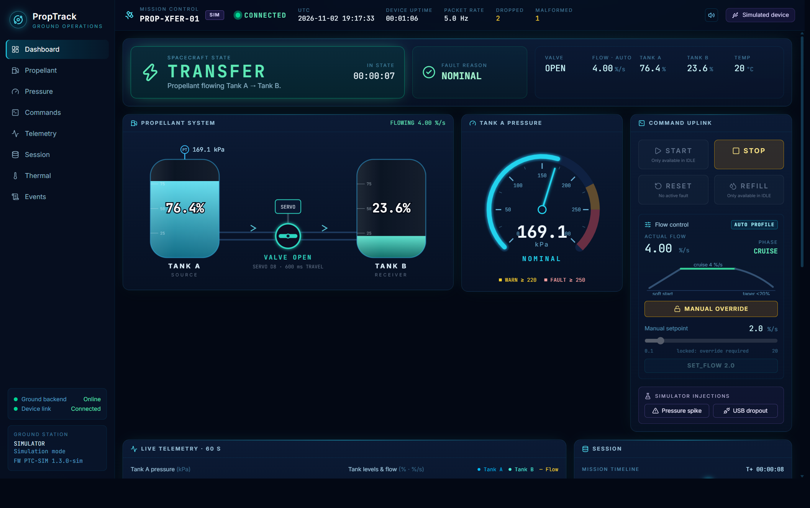

# Propellant Transfer Controller

A small hardware-in-the-loop model of a spacecraft propellant transfer system,
built around a SparkFun Pro Micro and a laptop ground station.

The idea came from wanting to work through the kind of problem real flight
software has to solve: you're moving fuel between two tanks through a valve,
and things can go wrong partway through. Pressure can climb, the propellant can
get too hot or too cold, or you can lose contact with the ground. The
controller has to notice, get the valve shut, and refuse to carry on until
someone on the ground has looked at it and said it's safe.



## What's in here

**The firmware** (`PropellantTransferController.ino`) runs on the
ATmega32U4. A potentiometer stands in for a tank pressure sensor, a push button
steps the tank temperature up and down, and a continuous rotation servo acts as
the fuel valve. The controller moves "propellant" from Tank A to Tank B, reports
everything as JSON over USB five times a second, and takes plain-text commands
back.

**The ground station** (`ground-station/`) is a Python backend and a React
dashboard. It shows the tanks, the valve, pressure and temperature live,
charts the last minute of data, logs everything to CSV, and sounds an alarm on
the laptop when something faults. It also has a simulator, so you can run the
whole thing without the board. Setup details are in
[ground-station/README.md](ground-station/README.md).

## How the controller works

The firmware is a five-state machine: `IDLE`, `OPENING`, `TRANSFER`,
`CLOSING`, `FAULT`.

```
  IDLE --START--> OPENING --valve open--> TRANSFER --tank empty / STOP--> CLOSING --> IDLE
                     |                       |
                     +------- fault ---------+--> CLOSING --valve shut--> FAULT --RESET--> IDLE
```

The main rule I designed around is that **a fault never leaves the valve
open**. When something goes wrong mid-transfer, the controller doesn't jump
straight to `FAULT`. It drives the valve closed first, and only latches the
fault once the valve is confirmed shut. The fault reason goes out to the
ground straight away, so the operator isn't kept waiting on the valve.

There are four things that can fault it:

| Fault | Trigger |
|-------|---------|
| `OVERPRESSURE` | Tank pressure reaches 250 kPa (there's a warning at 220) |
| `OVERTEMP` | Temperature above 40 °C |
| `UNDERTEMP` | Temperature below 10 °C (hydrazine freezes at about 2 °C) |
| `LINK_LOSS` | No traffic from the ground for 10 s during a transfer |

Getting out of `FAULT` takes a deliberate `RESET` from the ground, and the
firmware only accepts it once the cause has actually cleared: pressure below
150 kPa and temperature back in range.

Flow isn't constant either. By default the controller ramps the flow rate up
gently when the valve opens, holds it steady, then tapers off as Tank A
empties. The operator can take manual control, but has to ask for it
explicitly with `OVERRIDE ON`. Any fault hands control back to the automatic
profile.

## Some decisions worth mentioning

**There's no position sensor on the valve.** A continuous rotation servo only
knows speed, not angle, so the firmware tracks valve position itself, as
milliseconds of travel. That's what lets it reverse a half-finished opening
for exactly the right amount of time instead of guessing.

**Nothing blocks.** There isn't a single `delay()` in the firmware.
Everything is scheduled off `millis()`, so reading sensors, parsing commands,
driving the valve and sending telemetry never hold each other up. As a
backstop, the AVR hardware watchdog resets the chip if the main loop ever
stalls for 2 seconds. There's a hidden `DEBUG_HANG` command to prove that works.

**Memory is fixed.** The 32U4 has 2.5 KB of RAM, so commands are parsed in
place from a fixed buffer and there are no Arduino `String` objects anywhere.
The build sits at about 50% of flash and 39% of RAM.

**Every command gets an answer.** Every command is acknowledged with either
`ok` or a specific reason (`IN_FAULT`, `OVERRIDE_REQUIRED`,
`TEMP_OUT_OF_RANGE`, and so on). The dashboard uses the same rules to grey out
buttons in advance, but the firmware always has the final say.

**The pressure reading is smoothed.** The pot reading is filtered with a
moving average, and the warning has a few kPa of hysteresis so it doesn't
flicker on and off at the threshold.

## Hardware

| Pin | Connected to | Used for |
|-----|--------------|----------|
| A0  | Potentiometer wiper | Tank pressure, 0-300 kPa |
| D4  | Push button to GND | Tank temperature, 10 °C per press |
| D8  | Continuous servo signal | Fuel valve |
| D9  | Red LED | Fault (blinks once latched) |
| D10 | Yellow LED | Valve moving (blinks) or a warning (solid) |
| D16 | Green LED | Transfer running |

Board: SparkFun Pro Micro, 5 V / 16 MHz. The button uses the internal
pull-up, so it just needs to short D4 to ground.

## Running it

Flash the firmware from the Arduino IDE. You'll need the SparkFun AVR boards
package installed; select **SparkFun Pro Micro** and **ATmega32U4 (5V, 16 MHz)**.
The only library it uses is `Servo`, which comes with the IDE.

Then start the ground station:

```powershell
cd ground-station\backend
python -m venv .venv
.\.venv\Scripts\python.exe -m pip install -r requirements.txt
cd ..\frontend
npm install
npm run build
cd ..\backend
.\.venv\Scripts\python.exe main.py          # with the board plugged in
.\.venv\Scripts\python.exe main.py --sim    # or without it
```

Then open <http://127.0.0.1:8000>.

You don't strictly need the dashboard, though. The protocol is plain text, so
the Arduino Serial Monitor works fine (115200 baud, newline line endings):

```
PING            check the link
START           open the valve and start transferring
STOP            close the valve
OVERRIDE ON     take manual control of the flow rate
SET_FLOW 6.5    set the flow, in % of the tank per second
OVERRIDE OFF    go back to the automatic profile
RESET           clear a fault, once it's safe to
REFILL          put the fuel back in Tank A (only when idle)
```

If you start a transfer by hand, keep sending something (even just `PING`)
at least every 10 seconds, or the link watchdog will fault it. That's the
watchdog doing its job, not a bug.

## Built with

C++ on the Arduino toolchain for the firmware; Python with FastAPI, pyserial
and asyncio for the backend; and React, TypeScript, Vite, Tailwind CSS and
Recharts for the dashboard.

## Author

Solomon Osagie
